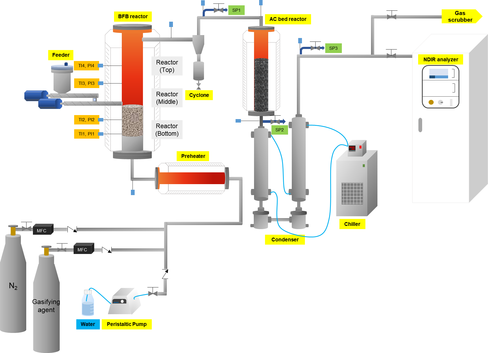
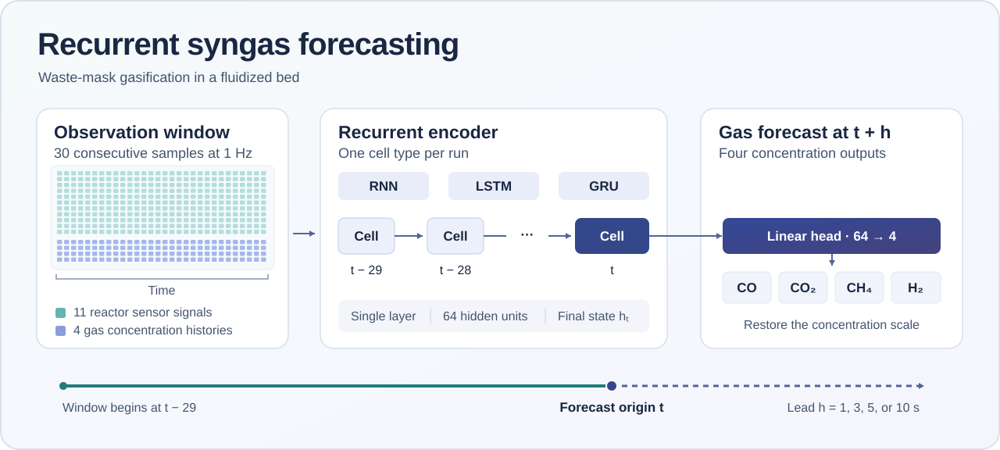

# Time-Series Soft Sensing of Syngas Evolution during Fluidized-Bed Gasification of Waste Masks

<p align="center">
  
  
  
</p>

**TimeSeries** is a PyTorch implementation of RNN, LSTM, and GRU models for forecasting syngas composition from measured gasification time series. The implementation is maintained by the [Network Science Lab at The Catholic University of Korea](https://nslab-cuk.github.io/).

## 1. Overview

Gas composition changes as waste-mask pellets enter the fluidized bed and react under different gasifying atmospheres. The study uses recent reactor signals and gas measurements to forecast **CO, CO₂, CH₄, and H₂** in the resulting syngas. The experiments cover air, CO₂, O₂/steam, and steam gasification.

### Experimental apparatus

<p align="center">
  
</p>
<p align="center"><em>Fig. 1. Schematic diagram of the experimental apparatus for waste-mask gasification.</em></p>

A screw feeder delivers the pellets into a bubbling fluidized bed of silica sand. Mass-flow controllers regulate the gas supply. In steam-containing experiments, a peristaltic pump supplies water that is vaporized and preheated with nitrogen. Temperature and pressure are monitored at different reactor heights. The cyclone removes entrained solids. The downstream setup shown in Fig. 1 includes an activated-carbon reactor and a condenser–chiller. A nondispersive infrared (NDIR) analyzer measures the product-gas concentrations.

### From reactor measurements to forecasts

The model takes 30 consecutive one-second observations ending at the forecast origin *t*. Each observation contains 11 selected reactor signals and four measured gas concentrations. Windows stay within uninterrupted records, and the standardization parameters are fitted to the training records alone. The forecaster uses the information recorded through *t* to predict all four concentrations at *t + h*, where *h* is 1, 3, 5, or 10 seconds.

<p align="center">
  
</p>
<p align="center"><em>Recurrent forecasting architecture used in the repository.</em></p>

RNN, LSTM, and GRU are fitted separately at each lead time. Each model uses one recurrent layer with 64 hidden units and a linear head that maps the final hidden state to four outputs. Predictions are converted back to the source concentration scale for evaluation. Real-time use depends on whether the analyzer readings are available by the forecast origin.

### Evaluation and findings

The revised experiment uses 10 training, 4 validation, and 2 test records. The two held-out records represent air and CO₂ gasification. The three architectures, four leads, and ten training seeds produce 120 fits on this fixed split. All models and the persistence baseline use the same test timestamps. Persistence carries forward the last gas values observed at *t*.

On the two test records, RNN had the lowest mean H₂ RMSE among the neural models at 1 and 3 s, and GRU at 5 and 10 s. At 10 s, persistence gave a lower mean H₂ RMSE than all three neural models. It also gave a lower mean CO₂ RMSE at every lead. The comparison describes performance on these two records and depends on both the gas and the forecast horizon.

## 2. Reproducibility

### Datasets

The protocol uses a fixed **10 training / 4 validation / 2 test** split by experimental record. Timestamp gaps or nonfinite selected measurements break the input sequences. Standardization uses training observations only. Every model and lead is evaluated at the same eligible test timestamps.

Preparing or replaying the experiment requires authorized access to the raw measurements or a completed job, respectively. For preparation, place all 17 gasification candidates under `data/raw/` using the relative paths from the [data manifest](metadata/data_manifest.csv). One candidate lacks an absolute clock and is excluded during preparation. See the [data placement guide](docs/DATA.md) for the directory structure and file checks.

### Requirements and environment setup

The recorded training environment used Python 3.11.18, PyTorch 2.5.1 with CUDA 12.4, and four NVIDIA RTX A5000 GPUs. The [environment record](metadata/environment_training.json) gives the complete per-worker details.

```bash
gh repo clone NSLab-CUK/Timeseries-Soft-Sensing-of-Syngas-Evolution
cd Timeseries-Soft-Sensing-of-Syngas-Evolution

python3.11 -m venv .venv
source .venv/bin/activate
python -m pip install -r requirements.txt
```

For preprocessing and checkpoint inference on CPU, install PyTorch with the CPU wheel index. The Linux GPU launcher below has its own CUDA environment setup.

```bash
python -m pip install torch==2.5.1 --index-url https://download.pytorch.org/whl/cpu
```

### Quick checks and data preparation

The first two commands work from a fresh clone without experimental records or GPUs. `inspect` lists the expected files. `--plan-only` shows the four-worker assignment without starting training.

```bash
python reproduce.py inspect
python scripts/run_4gpu.py --gpus 0,1,2,3 --plan-only --job syngas_forecasting
```

With authorized records in place, verify the raw file hashes, split, target timestamps, and training-only scaler. Use an empty output directory.

```bash
python reproduce.py prepare --output results/prepared
```

### Train on four GPUs

Run these commands from the repository root on Linux with the raw records in place. GPUs 0–3 handle leads 1, 3, 5, and 10 s, respectively. The launcher checks devices and runs short trial fits before the full experiment. Progress appears in the terminal and worker logs under `results/syngas_forecasting/`.

```bash
GPU_IDS=0,1,2,3 bash scripts/setup_env.sh
GPU_IDS=0,1,2,3 bash scripts/run_4gpu.sh --job syngas_forecasting
```

To continue an interrupted run of this checkout, repeat the launch command with `--resume` and the same job name. Use a new job name when source files or settings change.

### Replay checkpoints, evaluate, and plot

Place the authorized completed job under `permissioned_artifacts/training/`, with its `data_contract/` cache and `full/` training outputs intact. For a job trained using the commands above, use `--job-dir results/syngas_forecasting` instead.

```bash
python reproduce.py infer --job-dir permissioned_artifacts/training \
  --model gru --lead 10 --seed 20261113 --device cpu --output results/gru10_replay
python reproduce.py evaluate --job-dir permissioned_artifacts/training \
  --output results/evaluation
python reproduce.py plot --evaluation-dir results/evaluation --output results/plots
```

`infer` compares the selected checkpoint's predictions with saved predictions. `evaluate` recomputes MAE, MSE, RMSE, and R² for all 120 fits and scores persistence on the same targets. `plot` generates the standard comparison plots from the resulting tables. See [reproduction details](docs/REPRODUCIBILITY.md) and the [recorded checks](docs/VALIDATION.md).

### Training settings and aggregation

| Setting | Value |
| --- | --- |
| Architecture | One recurrent layer, 64 hidden units, four-output linear head |
| Input length | 30 consecutive observations |
| Leads | 1, 3, 5, and 10 seconds |
| Optimization | Adam with learning rate 0.001 and weight decay 0.0001, batch size 64 |
| Loss and stopping | L1 on standardized outputs, at most 200 epochs, validation patience 20 |
| Runs | 3 architectures × 4 leads × 10 seeds = 120 fits |

For each seed, the two test records receive equal weight when averaging the record-level scores. The paper reports the mean and sample standard deviation across the ten seeds. The seed repeats measure training variability within the fixed split.

The implementation for the revised experiment is in [`src/pipeline.py`](src/pipeline.py). [`configs/protocol.json`](configs/protocol.json) and [`configs/model_configs.csv`](configs/model_configs.csv) record the settings and fit assignments. The older analysis scripts are documented in [`archive/`](archive/README.md).

## 3. Reference and citation

Chae Eun Hyun, Ji Young Nam, Seo Yeon Ahn, Junhee Cho, Myung Won Seo, Dong Hyun Lee, O-Joun Lee, and Jun Young Kim. *Time series Soft Sensing of Syngas Evolution during Fluidized bed Gasification of Waste Masks Using Recurrent Neural Networks*. Manuscript.

For work using this implementation, cite the manuscript and include the [TimeSeries repository](https://github.com/NSLab-CUK/Timeseries-Soft-Sensing-of-Syngas-Evolution) and the commit used.

See the [license status](LICENSE_PENDING.md) for code reuse.
